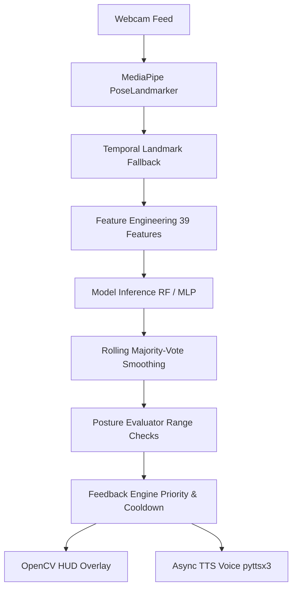

# Real-Time Personalized Yoga Pose Correction System

A production-grade, modular computer vision & machine learning system that performs real-time yoga pose recognition, posture alignment evaluation, and delivers directional corrective feedback through visual HUD overlays and voice prompts via webcam.

---

## Architecture Overview



### Key Guarantees
1. **Strict Training Parity**: Exact 39 engineered features extracted identically to the model training pipeline (`geometry.py` matches `yoga_engineered_features.csv`).
2. **Safe Imputation**: Only temporal fallback is used across consecutive video frames. No symmetry mirroring across the body center-line (preserving authentic asymmetric posture geometry).
3. **Throttled Speech & Feedback**: Cooldown timer (`cooldown_seconds: 12`) prevents repetitive audio spam; only the highest-priority/most-deviant joint correction is spoken.
4. **Non-blocking Camera Loop**: Video capture and skeleton rendering run at native camera frame-rate, while pose classification and posture evaluation run at configurable intervals (e.g. every 1.0–5.0 seconds).

---

## Directory Structure

```text
Yoga_posture_project/
├── config.yaml                   # Global runtime configuration
├── run_app.py                    # Application launcher with CLI options
├── pose_landmarker_full.task     # MediaPipe pose model asset
├── saved_yoga_model/             # Trained artifacts
│   ├── yoga_preprocessing.joblib # SimpleImputer, StandardScaler, LabelEncoder, feature_cols
│   ├── yoga_random_forest.joblib # Random Forest classifier (82.79% accuracy)
│   ├── yoga_mlp.keras            # Deep MLP classifier (77.56% accuracy)
│   └── yoga_hmm.npz              # Pose transition prior matrix
├── src/
│   ├── pose/
│   │   ├── landmark_extraction.py# MediaPipe PoseLandmarker wrapper
│   │   └── missing_landmarks.py  # Temporal fallback & visibility filtering
│   ├── features/
│   │   └── geometry.py           # 39-feature extraction (angles, distances, symmetry)
│   ├── models/
│   │   ├── model_loader.py       # Artifact validation and loading
│   │   └── inference.py          # Preprocessing + prediction + rolling vote buffer
│   ├── correction/
│   │   ├── reference_ranges.py   # Target angle ranges per asana
│   │   ├── posture_evaluator.py  # Range deviation detection & reliability checks
│   │   └── feedback_engine.py    # Deduplication, prioritization, sentence generation
│   └── app/
│       ├── voice.py              # Threaded, asynchronous pyttsx3 speech worker
│       ├── overlay.py            # OpenCV HUD, skeleton, and angle drawing
│       └── webcam_app.py         # Main execution loop
└── tests/
    └── test_pipeline.py          # 12 automated pytest unit & integration tests
```

---

## Quick Start

### 1. Launch the Live Application (Defaults to Warrior 2 Guided Practice)
```bash
python run_app.py
```
> The app starts initialized in **Guided Practice Mode for Virabhadrasana Two (Warrior 2)**. You can easily test knee bending and arm posture right away!

### 2. Common CLI Options
```bash
# Practice Warrior 1 instead of Warrior 2
python run_app.py --target-pose "Virabhadrasana One"

# Start in Free Auto-Detect mode across all 47 classes
python run_app.py --free

# Run with a 1-second inference interval
python run_app.py --interval 1.0

# Use the Neural Network (MLP) instead of Random Forest
python run_app.py --classifier mlp

# Run in silent mode (no voice feedback)
python run_app.py --no-voice

# Specify a custom webcam device index (e.g., external camera = 1)
python run_app.py --camera 1
```

---

## Live Keyboard Controls

While the camera window is active, use these interactive keys:

| Key | Action |
|:---:|:---|
| **`T`** or **`N`** | **Cycle Target Pose** (Warrior 2 → Warrior 1 → Chair → Triangle → Plank → Downward Dog → Tree) |
| **`M`** | **Toggle Mode** (Guided Target Pose vs Free 47-class Auto-Detect) |
| **`Q`** or **`ESC`** | Cleanly exit application |
| **`V`** | Toggle voice feedback ON / OFF |
| **`A`** | Toggle joint-angle numerical labels ON / OFF |
| **`+`** / **`=`** | Increase inference interval (+0.5s) |
| **`-`** | Decrease inference interval (-0.5s) |
| **`R`** | Reset prediction history buffer & speech cooldowns |
| **`S`** | Capture timestamped screenshot to `screenshots/` |

---

## Configuration (`config.yaml`)

```yaml
model:
  dir: saved_yoga_model
  mediapipe_task: pose_landmarker_full.task
  active_classifier: rf          # "rf" or "mlp"

inference:
  interval_seconds: 2            # Full pose evaluation every 2s
  smoothing_window: 5            # Majority-vote window length
  confidence_threshold: 0.45     # Confidence minimum
  visibility_threshold: 0.30     # MediaPipe landmark visibility filter

camera:
  device_index: 0
  width: 1280
  height: 720
  mirror: true                   # Flip horizontally for mirror view

display:
  show_landmarks: true
  show_skeleton: true
  show_angles: true
  show_confidence: true
  font_scale: 0.65
  max_feedback_lines: 4

voice:
  enabled: true
  rate: 155                      # Words per minute
  volume: 0.9
  cooldown_seconds: 12           # Seconds before repeating speech
```

---

## Adding or Modifying Reference Poses

To customize target posture angle ranges for any asana, edit [`src/correction/reference_ranges.py`](file:///e:/Yoga_posture_project/src/correction/reference_ranges.py):

```python
REFERENCE_RANGES = {
    "Virabhadrasana Two": {
        "left_knee_angle":   (85, 115),
        "right_knee_angle":  (160, 185),
        "left_elbow_angle":  (160, 185),
        "right_elbow_angle": (160, 185),
    },
    ...
}
```

The system automatically detects whether measured angles are `too_low` or `too_high`, calculates the exact deviation in degrees, validates that the underlying landmarks are reliable and visible, and constructs actionable, natural feedback.

---

## Running the Automated Test Suite

Run all 12 tests across feature extraction, preprocessing parity, posture evaluation, voice cooldowns, and interval handling:

```bash
python -m pytest tests/test_pipeline.py -v
```
