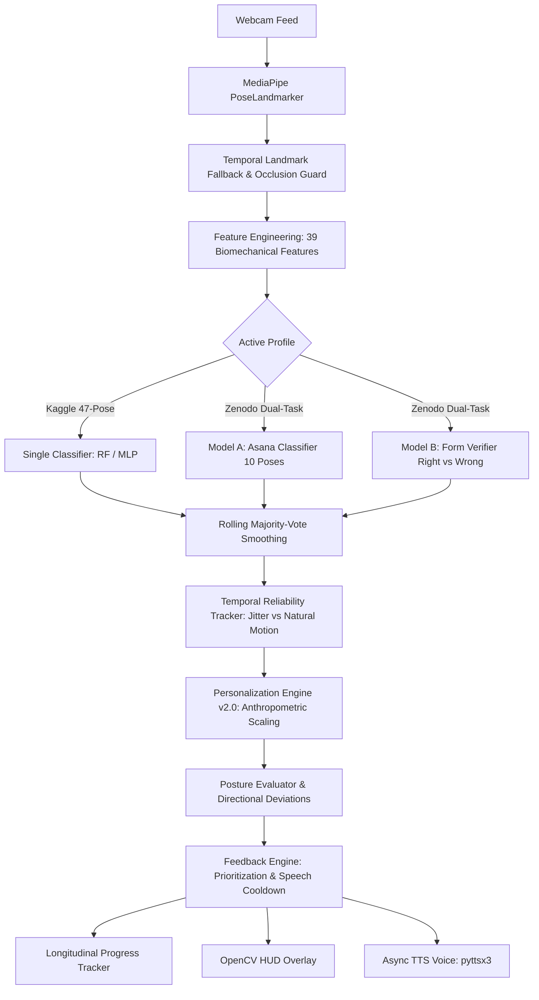

# Real-Time Personalized Yoga Posture Detection and Correction System (Yoga Mitra)

A production-grade, modular computer vision and machine learning system that performs real-time yoga pose recognition, form verification, and personalized directional corrective feedback through visual HUD overlays and voice prompts via webcam.

---

## Architecture Overview



### Key Guarantees & Systems

1. **Dual-Profile Switching**:
   - `--profile kaggle` (Default): 47-class pose classification on the Kaggle dataset.
   - `--profile zenodo`: Dual-task pipeline on the Zenodo dataset (`Model A`: 10-class Asana classifier, `Model B`: Form verifier distinguishing Right vs Wrong execution).
   - Safe fallback: If Zenodo model weights are not yet generated, the system falls back gracefully to the Kaggle profile with clear user notification.
2. **Strict Parity Across Training & Inference**:
   - Exact 39 engineered features extracted identically (`geometry.py` matches `scripts/prepare_zenodo_dataset.py`).
   - Group-stratified data splitting across 329 burst sessions to eliminate autocorrelated recording-date leakage while protecting minority classes (e.g., Vajrasana).
3. **Temporal Landmark Reliability**:
   - `TemporalReliabilityTracker` isolates high-frequency tremor/jitter (via second differences / acceleration) from genuine posture adjustments, suppressing noisy feedback during transitions.
   - Temporal imputation only across consecutive video frames (no artificial body-symmetry mirroring).
4. **Biomechanical Personalization v2.0**:
   - User calibration records arm-span, leg-to-torso, and shoulder-width ratios.
   - Reference angle boundaries dynamically adapt based on individual anthropometry and calibration stability variance.
5. **Longitudinal Progress Tracking**:
   - Aggregates multi-session performance, identifies recurring joint faults, and computes posture improvement trajectories.
6. **Throttled Speech & Feedback**:
   - Speech cooldown prevents audio spam; prioritizes the single most severe joint deviation.

---

## Directory Structure

```text
Yoga_posture_project/
├── config.yaml                          # Global runtime configuration
├── run_app.py                           # Application launcher with profile and CLI options
├── pose_landmarker_heavy (1).task       # MediaPipe pose model asset (Heavy)
├── ZENODO_IMPLEMENTATION_PLAN.md        # Comprehensive migration plan & audit report
├── EVALUATION.md                        # Evaluation metrics, latency benchmarks & robustness
├── saved_yoga_model/                    # Kaggle trained artifacts (47 classes)
│   ├── yoga_preprocessing.joblib        # Scaler, imputer, label encoder
│   ├── yoga_random_forest.joblib        # Random Forest model
│   ├── yoga_mlp.keras                   # MLP neural network
│   └── yoga_hmm.npz                     # Transition prior matrix
├── saved_yoga_model_zenodo/             # Zenodo model artifacts (Created upon training approval)
│   ├── zenodo_preprocessing.joblib      # Blueprint, scalers, encoders
│   ├── model_a_rf.joblib / model_a_mlp  # Task A: 10-Asana classifier
│   └── model_b_rf.joblib / model_b_mlp  # Task B: Right/Wrong form verifier
├── data/zenodo/                         # Prepared Zenodo features & metadata
│   ├── train_features.csv               # 7,993 training samples (39 features + labels)
│   ├── val_features.csv                 # 1,556 validation samples
│   ├── test_features.csv                # 1,569 held-out test samples
│   ├── candidate_reference_ranges.json  # Dataset-derived reference angle ranges
│   └── zenodo_preprocessing_blueprint.joblib # Feature names & label mapping
├── scripts/
│   ├── audit_zenodo.py                  # Dataset inspection & integrity checks
│   ├── prepare_zenodo_dataset.py        # 39-feature extraction & group-stratified splitting
│   ├── train_zenodo_models.py           # Dual-task training pipeline (Strictly gated)
│   ├── evaluate_zenodo_models.py        # Latency benchmarking & occlusion robustness
│   └── evaluate_system.py               # Kaggle pipeline evaluation suite
├── src/
│   ├── pose/
│   │   ├── landmark_extraction.py       # MediaPipe PoseLandmarker wrapper
│   │   └── missing_landmarks.py         # Temporal fallback & visibility filtering
│   ├── features/
│   │   └── geometry.py                  # 39-feature extraction (angles, distances, symmetry)
│   ├── models/
│   │   ├── model_loader.py              # Profile loader (Kaggle & Zenodo artifacts)
│   │   ├── inference.py                 # Single-task and Dual-task inference engines
│   │   └── zenodo_annotations.py        # Parser for group_id steps and fault tags
│   ├── correction/
│   │   ├── reference_ranges.py          # Reference angle ranges (Kaggle & Zenodo poses)
│   │   ├── posture_evaluator.py         # Range deviation detection & reliability checks
│   │   ├── feedback_engine.py           # Deduplication, prioritization, speech generation
│   │   ├── calibration.py               # v2.0 Biomechanical personalization & scaling
│   │   ├── reliability_tracker.py       # High-frequency jitter & stability estimator
│   │   └── progress_tracker.py          # Longitudinal session and fault history analytics
│   └── app/
│       ├── voice.py                     # Threaded, asynchronous pyttsx3 speech worker
│       ├── overlay.py                   # OpenCV HUD, skeleton, and angle drawing
│       ├── reference_display.py         # Reference pose cards & target pose profiles
│       └── webcam_app.py                # Main real-time application loop
└── tests/
    ├── test_pipeline.py                 # 26 legacy unit & integration tests
    └── test_zenodo_pipeline.py          # 12 Zenodo dual-task, calibration & reliability tests
```

---

## Quick Start

### 1. Launch the Live Application

```bash
# Launch with default Kaggle profile (Guided Practice: Warrior 2)
python run_app.py

# Launch with Zenodo profile (Guided Practice: Tadasana / Mountain Pose)
python run_app.py --profile zenodo

# Launch with user personalization calibration on startup
python run_app.py --calibrate

# Display longitudinal progress analytics report upon exit
python run_app.py --progress
```

### 2. Common CLI Options

```bash
# Practice specific guided pose
python run_app.py --target-pose "Tadasana"

# Start in Free Auto-Detect mode
python run_app.py --free

# Set inference interval (e.g. evaluate posture every 1.5s)
python run_app.py --interval 1.5

# Use the Neural Network (MLP) instead of Random Forest
python run_app.py --classifier mlp

# Run in silent mode (no voice feedback)
python run_app.py --no-voice

# Specify external camera index
python run_app.py --camera 1
```

---

## Live Keyboard Controls

| Key | Action |
|:---:|:---|
| **`T`** or **`N`** | **Cycle Target Pose** (cycles through guided poses for active profile) |
| **`M`** | **Toggle Mode** (Guided Target Pose vs Free Auto-Detect) |
| **`V`** | Toggle voice feedback ON / OFF |
| **`A`** | Toggle joint-angle numerical labels ON / OFF |
| **`+`** / **`=`** | Increase inference interval (+0.5s) |
| **`-`** | Decrease inference interval (-0.5s) |
| **`R`** | Reset prediction history buffer & speech cooldowns |
| **`S`** | Capture timestamped screenshot to `screenshots/` |
| **`Q`** or **`ESC`** | Cleanly exit application (prints longitudinal summary if `--progress` is enabled) |

---

## Zenodo Migration Pipeline

The project includes an end-to-end migration pipeline for the 11,118-sample Zenodo yoga dataset (`zenodo_yoga_landmarks - zenodo_yoga_landmarks.csv`):

### 1. Dataset Preprocessing & Feature Extraction
Transforms raw MediaPipe 132 coordinates into 39 biomechanical features, groups frames into 329 burst sessions, and performs group-stratified train/val/test splits:
```bash
python scripts/prepare_zenodo_dataset.py
```
Outputs:
- `data/zenodo/train_features.csv` (7,993 samples)
- `data/zenodo/val_features.csv` (1,556 samples)
- `data/zenodo/test_features.csv` (1,569 samples)
- `data/zenodo/candidate_reference_ranges.json`
- `data/zenodo/zenodo_preprocessing_blueprint.joblib`

### 2. Dual-Task Model Training (RF & MLP)
The training script trains Model A (10-pose classifier) and Model B (form verifier).
It supports training Random Forest, MLP, or both architectures with automatic champion selection:
```bash
# Train both architectures (RF & MLP) and evaluate champions
python scripts/train_zenodo_models.py --execute-training-approved --model-type both
```
Artifacts are saved to:
- `saved_yoga_model_zenodo/` (Active champion model)
- `saved_yoga_model_zenodo/rf/` (Random Forest models)
- `saved_yoga_model_zenodo/mlp/` (MLP models)

### 3. Latency Benchmarking & Occlusion Robustness Evaluation
Evaluates real-time feature extraction speed and occlusion degradation handling:
```bash
python scripts/evaluate_zenodo_models.py
```
- **Mean Feature Extraction Latency**: ~0.26 ms (comfortably supports >60 FPS).
- **Occlusion Suppression**: 100% of unreliable predictions suppressed at 25% and 50% landmark occlusion.

---

## Supported Asanas

### Kaggle Guided Practice Poses (7 Poses)
- Virabhadrasana Two (Warrior 2)
- Virabhadrasana One (Warrior 1)
- Utkatasana (Chair Pose)
- Trikonasana (Triangle Pose)
- Phalakasana (Plank Pose)
- Adho Mukha Svanasana (Downward Dog)
- Vrikshasana (Tree Pose)

### Zenodo Guided Practice Poses (10 Poses)
- **Tadasana** (Mountain Pose)
- **Bhujangasana** (Cobra Pose)
- **Marjariasana** (Cat-Cow Pose)
- **Parvatasana** (Mountain / Seated Upward Stretch)
- **Ardhakati Chakrasana** (Lateral Standing Side Bend)
- **Kati Chakrasana** (Standing Spinal Twist)
- **Vajrasana** (Thunderbolt Pose)
- **Anantasana** (Side Reclining Leg Lift)
- **Sarvangasana** (Shoulder Stand)
- **Viparita Karani** (Legs-up-the-Wall / Inverted Pose)

---

## Running the Automated Test Suite

The test suite validates both legacy components and the Zenodo dual-task pipeline across 39 tests:

```bash
python -m pytest tests/ -v
```

- **`tests/test_pipeline.py` (26 tests)**:
  - Feature extraction shape, order, and invariance
  - Preprocessing pipeline mathematical parity
  - Pose evaluation range checks and deviation calculations
  - Feedback cooldown and voice prioritization
  - Landmark visibility thresholds and temporal fallback
- **`tests/test_zenodo_pipeline.py` (13 tests)**:
  - Group-stratified split verification and zero leakage
  - Dual-task inference with mock models and probability thresholds
  - Zenodo reference ranges and provisional metadata validation
  - Biomechanical personalization v2.0 adaptation
  - Temporal reliability tracker (jitter vs natural movement)
  - Longitudinal progress tracker aggregation and report formatting
  - Model loader profile fallback behavior
  - Gravitational posture prior (physically separates standing from prone/inverted poses)
